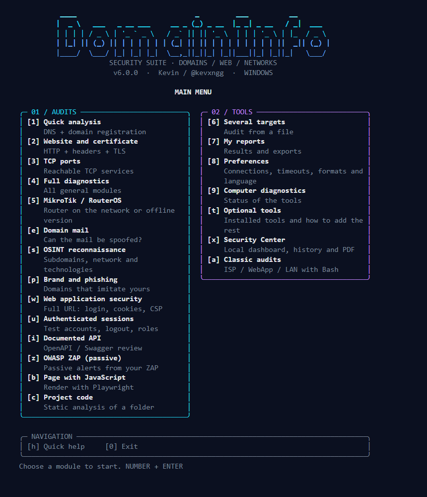

# DomainInfo 6.0 Security Suite (alfa · Fase 1)

Diagnóstico de dominios, IPs y aplicaciones web para **Termux, Kali/Linux, macOS y Windows**, por [@kevxngg](https://github.com/kevxngg).

> 6.0 está en desarrollo por fases. La **Fase 1** (URL completa, módulo `webapp` pasivo, modelo de evidencias y
> nueva puntuación) está hecha; el diseño y las fases siguientes están en [docs/V6_DESIGN.md](docs/V6_DESIGN.md).

El núcleo portable usa **Python 3.10+ y su biblioteca estándar**: no requiere pip, root, Bash, Nmap ni compiladores. Los módulos Bash de la versión 3 se conservan para auditorías avanzadas; sus requisitos y limitaciones son distintos.

## Menú interactivo

Logo ASCII propio, colores cian/azul, paneles de auditorías y herramientas y distribución adaptable: dos columnas en escritorio y paneles apilados en terminales estrechas. Las pantallas del asistente mantienen el mismo estilo de bordes y navegación.



Vista compacta: [menú para terminal estrecha](docs/assets/menu-mobile.png). Las imágenes se renderizaron a partir de la salida del menú; los colores y la fuente finales dependen de tu terminal.

Abre el programa sin objetivo para usar el asistente:

```bash
domaininfo
# O desde la carpeta del proyecto:
python3 domaininfo.py
bash domaininfo.sh
```

En Windows: `python domaininfo.py` o `.\domaininfo.cmd`. También puedes abrirlo explícitamente con `python3 domaininfo.py --interactive`.

El menú permite elegir auditoría, introducir el objetivo, revisar opciones e iniciar. Incluye:

- **MikroTik**: revisar un router en la red o comparar una versión sin conexión.
- **Opciones por auditoría**: puertos, módulos, conexión HTTP/HTTPS y versión RouterOS.
- **Progreso y resúmenes**: direcciones, servicios accesibles, certificado y avisos aplicables, sin mostrar JSON crudo por defecto.
- **Varios objetivos**: cargar un archivo, revisar el número de objetivos válidos y elegir el modo.
- **Mis reportes**: consultar resultados recientes y abrir su HTML en el navegador si está disponible.
- **Preferencias y diagnóstico**: tiempo por conexión, concurrencia, formatos y carpeta de resultados.
- **Auditorías clásicas**: acceso a los módulos Bash cuando el entorno tiene sus dependencias.

En una terminal real basta con **pulsar la tecla** de la opción, sin ENTER (con `DOMAININFO_ENTER=1` vuelve el modo número + ENTER, que también se usa en listas de más de nueve elementos); **0 vuelve** al menú anterior. CTRL+C cancela la acción actual. El programa regresa al inicio después del reporte y permite repetir auditorías. Las preferencias duran la sesión. El diseño adapta el ancho de las líneas a la terminal; los colores se desactivan con `NO_COLOR`, terminal básica o salida redirigida. No necesita librerías de interfaz adicionales.

Las pantallas muestran **[0 / r] Regresar**. También puedes escribir `regresar` o `volver`; los cambios de preferencias se conservan al regresar. En MikroTik, cancelar la entrada vuelve a su submenú. En el inicio, `0` sale del programa y `r` permanece en el menú principal.

Los resultados se presentan en español: comprobaciones terminadas, errores explicados y servicios que respondieron. **Ver resultados explicados** describe cada aviso de RouterOS y muestra el parche de la rama aplicable. **Ver datos JSON** conserva la información técnica completa como opción separada. Al salir no hay despedidas personalizadas; el nombre del autor aparece únicamente como crédito.

En el asistente, una URL conserva protocolo y puerto; se revisa la raíz del sitio. Para HTTP se omite automáticamente TLS en los modos web/completo, salvo que vuelvas a activarlo desde los módulos. Con un objetivo en la línea de comandos verás un resumen legible; para automatizar se conserva el JSON (ver [Uso en la terminal](#uso-en-la-terminal)).

## Instalación

### Como comando con pipx (Linux, macOS, Windows y Termux)

```bash
pipx install git+https://github.com/kevxngg/domaininfo
domaininfo --doctor
domaininfo example.com
```

Instala el núcleo portable como el comando `domaininfo`, disponible en cualquier carpeta. Actualiza con `pipx upgrade domaininfo`. Los módulos Bash clásicos necesitan clonar el repositorio con los pasos de abajo.

### Termux

```bash
pkg update
pkg install git python
cd "$HOME"
git clone https://github.com/kevxngg/domaininfo.git
cd domaininfo
bash install.sh
domaininfo --doctor
domaininfo example.com
```

Trabaja dentro de `$HOME`, en vez del almacenamiento compartido de Android. El instalador utiliza `$PREFIX/bin`, no `/usr/bin`, no ejecuta sudo y no actualiza pip. Si falla `pkg`, revisa el error visible, la conexión y los repositorios con `termux-change-repo`. Consulta la [guía oficial de paquetes de Termux](https://github.com/termux/termux-packages/wiki/Package-Management).

### Kali y otras distribuciones Linux

```bash
git clone https://github.com/kevxngg/domaininfo.git
cd domaininfo
bash install.sh
python3 domaininfo.py --doctor
python3 domaininfo.py example.com
```

El instalador detecta apt, dnf o pacman si falta Python. El comando `domaininfo` se guarda en `~/.local/bin`; añade esa carpeta a PATH si hace falta. No ejecutes toda la aplicación con sudo.

### macOS

Instala Python 3.10+ (por ejemplo, `brew install python` si ya utilizas Homebrew), clona el repositorio y ejecuta:

```bash
bash install.sh
python3 domaininfo.py example.com
```

El núcleo portable no depende del Bash 3.2 del sistema ni de herramientas GNU.

### Windows (PowerShell o CMD)

Instala Python 3.10+ con su opción de PATH y Git. Abre una terminal nueva:

```powershell
git clone https://github.com/kevxngg/domaininfo.git
cd domaininfo
python domaininfo.py --doctor
.\domaininfo.cmd example.com
```

También puedes usar `py -3 domaininfo.py example.com`. El instalador opcional `install.ps1` solo verifica Python y el diagnóstico. Si PowerShell bloquea scripts, utiliza directamente `python domaininfo.py`; no necesitas cambiar la política del equipo.

## Funciones portables

| Modo | Tecla en el menú | Funciones |
|---|---|---|
| `quick` (predeterminado) | 1 | Direcciones, registros DNS (MX, NS, TXT, SOA, CAA, CNAME), DNSSEC y registro RDAP |
| `web` | 2 | DNS, HTTP, certificado TLS a fondo y huella tecnológica con nota de cabeceras |
| `ports` | 3 | DNS y conexiones TCP concurrentes, sin sockets RAW |
| `full` | 4 | Todo lo general: DNS, RDAP, red (ASN), web, TLS, tecnologías, correo, subdominios, historia, puertos y traceroute |
| `mikrotik` | 5 | RouterOS 6/7: servicios de gestión, versión y avisos de seguridad recientes |
| `mail` | e | Seguridad del correo: SPF, DMARC, DKIM, MTA-STS, TLS-RPT y BIMI, con nota y si se puede suplantar |
| `recon` | s | Reconocimiento OSINT: subdominios (Certificate Transparency), posible toma de subdominios, red, tecnologías e historia |
| `brand` | p | Marca y phishing: dominios parecidos registrados (errores de tecleo, homoglifos, otros TLD) y si reciben correo |
| `webapp` | w | Seguridad de una URL concreta (pasivo): formularios, CSRF, cookies, CSP, clickjacking, CORS, errores técnicos y datos expuestos |

### Novedades de la versión 6 (Fase 1)

**Seguridad de aplicaciones web** con `-m webapp`. Se audita exactamente la URL indicada: protocolo, host,
puerto, ruta y parámetros se conservan (`/login` no se sustituye por `/`).

```bash
python3 domaininfo.py -m webapp --url https://example.com/login
python3 domaininfo.py -m webapp https://app.example.com:8443/admin?tab=1
python3 domaininfo.py -m webapp --url https://app.example.com/ --scope auth.example.com,*.cdn.example.com
python3 domaininfo.py -m webapp -f urls.txt --format all       # una URL por línea
python3 domaininfo.py -m webapp --url http://127.0.0.1:8000/login   # tu aplicación en local
```

Qué revisa, **solo con peticiones GET y sin enviar formularios ni credenciales**:

- Formularios: método y destino, campos de usuario y contraseña, contraseña por GET o por HTTP.
- CSRF: token visible en el formulario (evidencia directa), token en `<meta>` o cookies SameSite (protección
  alternativa) o **pendiente de verificar** si no hay evidencia. Un formulario sin token **no** se declara vulnerable.
- Cookies: `Secure`, `HttpOnly`, `SameSite` (los valores nunca se guardan).
- Cabeceras: HSTS, análisis de la CSP (`unsafe-inline`, `unsafe-eval`, comodines, `object-src`, `base-uri`),
  clickjacking (`X-Frame-Options`/`frame-ancestors`), `Referrer-Policy`, `Permissions-Policy`, `nosniff`, versiones expuestas.
- CORS: una petición con un `Origin` ficticio para ver si se refleja y si permite credenciales.
- Redirecciones: se siguen solo dentro del alcance (máx. 5); se marcan las que bajan de HTTPS a HTTP.
- Errores técnicos (trazas de Python, Java, PHP, .NET, Node, SQL…) y datos sensibles en la respuesta (claves privadas,
  claves de AWS, tokens), con la evidencia ocultada.
- Comparación con la raíz del sitio, para demostrar que la página auditada es la pedida.

Cada hallazgo incluye identificador, ruta, categoría, gravedad, **estado** (confirmado, probable, informativo,
pendiente de verificar, no aplicable, no evaluado, error), confianza, evidencia ocultada, herramienta, impacto,
verificación segura, corrección y referencias CWE/OWASP. El reporte añade `assessment` con tres puntuaciones:
**Security** (riesgo de lo comprobado), **Coverage** (parte comprobada) y **Confidence** (parte con evidencia
directa). La nota clásica `score` (A–F) se mantiene igual.

**Seguridad de la propia herramienta**: solo `http`/`https`, sin credenciales en la URL; alcance limitado al host de
la URL más `--scope`; cada host se resuelve una vez y la conexión va a esa IP (contra DNS rebinding); nunca se
visitan direcciones de enlace local (como `169.254.169.254`), multicast o reservadas; un objetivo público no puede
redirigir a redes internas salvo con `--allow-private`; límite de 1 MiB por respuesta. Un certificado no válido
detiene el módulo salvo que uses `--insecure-tls`, que queda indicado en el reporte.

**Herramientas opcionales**: `--doctor` muestra en `integrations` si Nmap, Subfinder, Amass, dnsx, httpx, WhatWeb,
ZAP, Nuclei, Playwright, SSLyze, testssl.sh, Semgrep, Bandit, pip-audit, Trivy y Gitleaks están instaladas, su versión,
si es compatible y cómo instalarlas. En esta fase solo se detectan; DomainInfo funciona igual sin ellas y nunca
descarga ni ejecuta binarios por su cuenta.

### Novedades de la versión 5

Todo sigue funcionando **solo con Python estándar**, sin pip ni root:

- **Cliente DNS propio** (UDP/TCP y DNS sobre HTTPS si el puerto 53 está bloqueado): MX, NS, TXT, SOA, CAA, CNAME, PTR y DNSSEC. Con `--resolver IP` eliges el servidor.
- **Correo**: nota A–F y aviso claro cuando cualquiera puede enviar correos falsos en nombre del dominio.
- **TLS a fondo**: versiones aceptadas (avisa si sigue aceptando TLS 1.0/1.1), nombres del certificado y, si no es válido, el motivo (autofirmado, nombre incorrecto, caducado) en vez de un error.
- **Red**: sistema autónomo, operador, bloque y país de cada IP (Team Cymru por DNS).
- **Huella del sitio**: tecnologías (CMS, CDN, frameworks, analítica), nota de las cabeceras de seguridad, cookies sin protecciones, redirecciones, `security.txt`, `robots.txt` y el **hash del favicon** listo para buscar en Shodan (`http.favicon.hash:...`).
- **Subdominios** desde los registros públicos de certificados (crt.sh y Cert Spotter) y, con `--brute`, la lista de palabras; detecta **CNAME abandonados** que podrían permitir tomar el subdominio (GitHub Pages, Heroku, S3, Azure, Shopify, Netlify y más).
- **Historia**: antigüedad y caducidad del dominio, registrador y primera/última captura en la Wayback Machine. Un dominio de menos de 90 días se marca como reciente.
- **Dominios parecidos** para proteger una marca contra phishing.
- **Nota global de seguridad (0–100, A–F)** con cada hallazgo, su gravedad y cómo arreglarlo, en la terminal y en los reportes.
- **Varios objetivos** (`-f`): además de un reporte por objetivo, un **mapa de infraestructura** (qué objetivos comparten IP, red, DNS, correo, certificado o favicon) y un **resumen CSV**.
- **Reportes**: HTML con nota, hallazgos y secciones (el JSON completo queda dentro), TXT legible y Markdown con `--format md`.

Incluye dominios internacionales (IDNA), archivos batch UTF-8 con BOM/CRLF, eliminación de duplicados, errores por módulo, reportes JSON/TXT/HTML/MD, escritura atómica y nombres únicos. El JSON conserva la estructura anterior y solo añade campos (`score`, módulos nuevos, `records` en DNS). Los reportes HTML escapan el contenido remoto.

```bash
python3 domaininfo.py                          # Menú interactivo
python3 domaininfo.py example.com
python3 domaininfo.py -m web example.com
python3 domaininfo.py -m ports --ports 22,80,443 --timeout 2 -t 8 127.0.0.1
python3 domaininfo.py -m quick -s rdap ::1
python3 domaininfo.py -f targets.txt -m web -o logs --format all
python3 domaininfo.py -m full -s ports -s traceroute example.com
python3 domaininfo.py -m mail example.com        # ¿Se puede suplantar el correo?
python3 domaininfo.py -m recon --brute example.com
python3 domaininfo.py -m brand mimarca.com       # Dominios que imitan tu marca
python3 domaininfo.py -f dominios.txt -m full    # Reportes + mapa de infraestructura + CSV
python3 domaininfo.py -q -s rdap localhost      # Solo JSON en stdout
python3 domaininfo.py --doctor                 # Diagnóstico local sin red
python3 domaininfo.py --help
```

En Windows sustituye `python3` por `python` o `py -3`.

`-t` limita conexiones TCP y consultas paralelas a 1–64 trabajadores. Los módulos de correo, subdominios, historia y dominios parecidos solo aplican a dominios: con una IP aparecen como omitidos. `--timeout` limita cada operación de conexión/lectura, entre 0.1 y 60 segundos; la resolución DNS del sistema y las redirecciones no tienen un límite global. `-s` puede repetirse. `--scheme http --web-port 8080` permite inspeccionar un servidor local. En los modos clásicos una URL se normaliza a su host; configura protocolo y puerto con estas opciones. Para auditar una ruta concreta (por ejemplo `/login`) usa `-m webapp`, que conserva la URL completa.

## Uso en la terminal

**Salida legible o JSON.** En una terminal, `domaininfo example.com` muestra un resumen con colores: direcciones, estado HTTP, certificado con su fecha de caducidad, puertos que respondieron con el nombre habitual del servicio y la carpeta de los reportes. Si la salida va a otro programa o a un archivo, o usas `--json` o `-q`, se imprime el JSON de siempre, un documento por objetivo, así que los scripts existentes siguen funcionando.

```bash
domaininfo example.com                 # resumen legible
domaininfo example.com --json          # JSON en una línea
domaininfo example.com --pretty        # JSON con sangría
domaininfo example.com | jq .          # en una tubería sale JSON automáticamente
domaininfo -m web example.com --open   # abre el reporte HTML al terminar
```

**Certificados.** El resumen avisa en amarillo si el certificado caduca en 30 días o menos y en rojo si ya caducó. El JSON del módulo TLS incluye `expires` y `expiry_warning` (`soon`, `expired` o `null`).

**Vigilancia.** `--watch SEGUNDOS` repite la revisión (mínimo 5 s) y solo avisa cuando algo cambia: direcciones, estado HTTP, cabeceras, certificado renovado, puertos que se abren o cierran, versión RouterOS o un módulo que empieza a fallar. Se guarda un reporte en cada cambio. CTRL+C termina.

```bash
domaininfo -m web --watch 300 example.com
domaininfo -m ports --ports 22,443 --watch 60 192.168.1.10
domaininfo -m web --watch 600 -q example.com   # eventos JSON {"event": "change", ...}
```

**Autocompletado con TAB.** `install.sh` instala el de Bash en la carpeta estándar de bash-completion. También puedes cargarlo a mano:

```bash
eval "$(domaininfo --completion bash)"   # en ~/.bashrc
eval "$(domaininfo --completion zsh)"    # en ~/.zshrc
```

En PowerShell añade a tu perfil (`notepad $PROFILE`): `domaininfo --completion powershell | Out-String | Invoke-Expression`. Completa opciones, modos, módulos de `-s` y formatos.

**Actualizar.** `domaininfo --update` muestra la versión instalada y la última publicada; en una copia clonada ejecuta `git pull --ff-only` y en otras instalaciones indica el comando de `pipx` o `pip`.

`domaininfo --help` explica cada opción con sus valores por defecto y ejemplos.

Código de salida: `0` sin errores, `1` si hay objetivos inválidos, módulos fallidos o error al guardar, `2` para argumentos inválidos y `130` al interrumpir. Un módulo omitido o traceroute no disponible no invalida los demás resultados.

### Auditoría MikroTik / RouterOS

```bash
# Equipo propio/autorizado: conexiones TCP y lectura de banners públicos
python3 domaininfo.py -m mikrotik 192.168.88.1

# Si el equipo no publica su versión, indícala desde tu inventario
python3 domaininfo.py -m mikrotik --routeros-version 7.25 192.168.88.1

# Revisar una versión sin conectar con ningún equipo ni servicio de Internet
python3 domaininfo.py -m mikrotik --offline --routeros-version 7.24.2

# Servicios en puertos personalizados
python3 domaininfo.py -m mikrotik --ports 2222,8443 --ssh-port 2222 --web-port 8443 192.168.88.1
```

El catálogo revisado el **26 de octubre de 2026** cubre seis avisos de septiembre de 2026 publicados por MikroTik/CERT Polska, con rangos separados para RouterOS 6 y 7. Incluye la corrección posterior del aviso de certificados; distingue stable de los parches de la rama long-term. Las versiones de referencia de la instantánea son stable **7.25**, long-term **7.23.8** y rama 6 **6.49.23**. Son referencias fechadas, no una consulta automática de actualizaciones.

No prueba contraseñas, no ejecuta exploits y no cambia la configuración. Un resultado `potentially_affected` corresponde a la versión informada; no confirma explotación. `not_in_affected_range` se refiere solamente a los seis avisos del catálogo y no significa que el equipo sea seguro. Sin versión, con datos contradictorios o con beta/rc solicita revisión manual. El código de salida indica si se completó el diagnóstico, no si hay avisos aplicables.

Disponible en el menú nuevo, opción **5**; en el menú Bash clásico (`--legacy`), opción **9**, y directamente mediante `bash domaininfo.sh --mikrotik ...`. Los reportes usan los mismos formatos JSON/TXT/HTML. Detalles, fuentes y límites en [docs/MIKROTIK.md](docs/MIKROTIK.md).

### Límites de los resultados

- DNS portable consulta A/AAAA mediante el resolver del sistema. Los registros MX/TXT/NS y los módulos especializados siguen disponibles en Bash.
- RDAP envía el objetivo a `rdap.org` y al registro al que redirige. Requiere Internet y puede fallar por límites del servicio. Usa `-s rdap` para omitirlo.
- HTTP/TLS verifica certificados con el almacén de confianza de Python, siguiendo las [recomendaciones oficiales de Python](https://docs.python.org/3/library/ssl.html#ssl.create_default_context). No omite errores de confianza automáticamente.
- Un header ausente o un puerto abierto es una observación; no confirma por sí solo una vulnerabilidad ni un CVE.
- `webapp` es pasivo: no ejecuta JavaScript (no ve formularios creados dinámicamente), no envía formularios y no
  comprueba en el servidor la protección CSRF; por eso un formulario sin token queda como *pendiente de verificar*.
- Traceroute usa `tracert` en Windows o `traceroute`/`tracepath` en Unix. Android puede limitarlo; se informa su ausencia y no se inventan saltos con conexiones TCP.

## Módulos Bash clásicos

```bash
bash install.sh --legacy
bash domaininfo.sh --legacy                   # Menú clásico
bash domaininfo.sh -m quick example.com
bash domaininfo.sh -m full -j -t 15 example.com
bash domaininfo.sh --portable --doctor
bash domaininfo.sh --mikrotik --offline --routeros-version 7.25
```

Para los módulos clásicos se necesita **Bash 4+**, curl, dig y las herramientas específicas de cada módulo (WHOIS, Nmap, OpenSSL, timeout/coreutils). En macOS ejecuta el Bash instalado por Homebrew; se reconoce `gtimeout`. Windows nativo usa el núcleo Python; los módulos clásicos requieren WSL/Linux y sus dependencias.

Se mantienen DNS extendido, geolocalización, WHOIS, subdominios, blacklists, stack web y los módulos de auditoría web/ISP/LAN. Son código heredado: algunos resultados son heurísticos y el acceso a interfaces, MAC/WiFi o sockets RAW depende del sistema y sus permisos. **No se garantiza paridad de auditorías WiFi entre Android, macOS y Windows.** La documentación histórica se conserva en [docs/LEGACY.md](docs/LEGACY.md); sus afirmaciones de cobertura de CVEs no equivalen a comprobaciones confirmadas.

## Pruebas y correcciones

```bash
python3 -m unittest discover -s tests -v
# Opcional (desarrollo): pruebas de propiedades y análisis estático
pip install hypothesis ruff bandit pyright
```

Las pruebas usan servicios locales y mocks para RDAP/TLS, sin auditar dominios ajenos. GitHub Actions ejecuta la suite con Python 3.10, 3.12 y 3.14 en Ubuntu, macOS y Windows. Termux requiere verificación manual en un dispositivo Android; los runners de GitHub no lo reproducen. Detalles de errores corregidos: [docs/FIXES.md](docs/FIXES.md).

Reportes en `logs/` (ignorados por Git). Utiliza los módulos activos solo sobre sistemas que tengas autorización para evaluar.

Licencia MIT. Autor: [@kevxngg](https://github.com/kevxngg).
