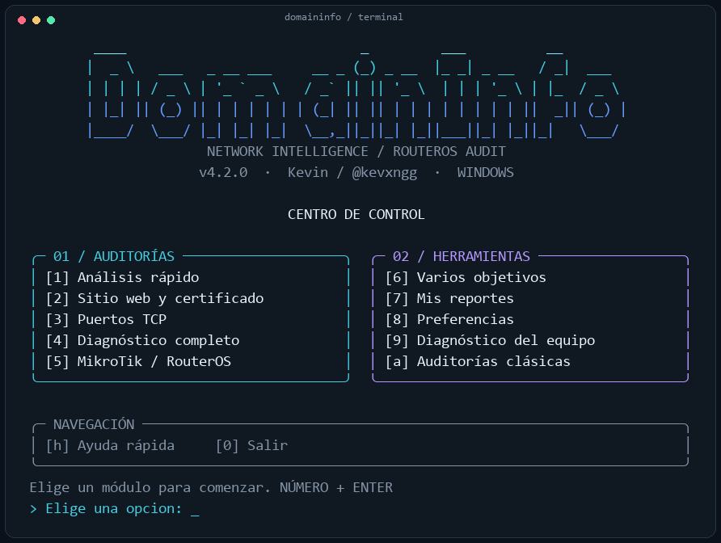

# DomainInfo 4.2

Diagnóstico de dominios e IPs para **Termux, Kali/Linux, macOS y Windows**, por [@kevxngg](https://github.com/kevxngg).

El núcleo portable usa **Python 3.10+ y su biblioteca estándar**: no requiere pip, root, Bash, Nmap ni compiladores. Los módulos Bash de la versión 3 se conservan para auditorías avanzadas; sus requisitos y limitaciones son distintos.

## Menú interactivo

Logo ASCII propio, colores cian/azul, paneles de auditorías y herramientas y distribución adaptable: dos columnas en escritorio y paneles apilados en terminales estrechas. Las pantallas del asistente mantienen el mismo estilo de bordes y navegación.



Vista compacta: [menú para terminal estrecha](docs/assets/menu-mobile.png). Las imágenes se renderizaron a partir de la salida del menú; los colores y la fuente finales dependen de tu terminal.

Abre el programa sin objetivo para usar el asistente:

```bash
domaininfo
# O desde la carpeta del proyecto:
python3 domaininfo.py
bash domaininfo.sh
```

En Windows: `python domaininfo.py` o `.\domaininfo.cmd`. También puedes abrirlo explícitamente con `python3 domaininfo.py --interactive`.

El menú permite elegir auditoría, introducir el objetivo, revisar opciones e iniciar. Incluye:

- **MikroTik**: revisar un router en la red o comparar una versión sin conexión.
- **Opciones por auditoría**: puertos, módulos, conexión HTTP/HTTPS y versión RouterOS.
- **Progreso y resúmenes**: direcciones, servicios accesibles, certificado y avisos aplicables, sin mostrar JSON crudo por defecto.
- **Varios objetivos**: cargar un archivo, revisar el número de objetivos válidos y elegir el modo.
- **Mis reportes**: consultar resultados recientes y abrir su HTML en el navegador si está disponible.
- **Preferencias y diagnóstico**: tiempo por conexión, concurrencia, formatos y carpeta de resultados.
- **Auditorías clásicas**: acceso a los módulos Bash cuando el entorno tiene sus dependencias.

Escribe números y pulsa ENTER; **0 vuelve** al menú anterior. CTRL+C cancela la acción actual. El programa regresa al inicio después del reporte y permite repetir auditorías. Las preferencias duran la sesión. El diseño adapta el ancho de las líneas a la terminal; los colores se desactivan con `NO_COLOR`, terminal básica o salida redirigida. No necesita librerías de interfaz adicionales.

En el asistente, una URL conserva protocolo y puerto; se revisa la raíz del sitio. Para HTTP se omite automáticamente TLS en los modos web/completo, salvo que vuelvas a activarlo desde los módulos. La CLI con objetivo conserva su salida JSON para automatización.

## Instalación

### Termux

```bash
pkg update
pkg install git python
cd "$HOME"
git clone https://github.com/kevxngg/domaininfo.git
cd domaininfo
bash install.sh
domaininfo --doctor
domaininfo example.com
```

Trabaja dentro de `$HOME`, en vez del almacenamiento compartido de Android. El instalador utiliza `$PREFIX/bin`, no `/usr/bin`, no ejecuta sudo y no actualiza pip. Si falla `pkg`, revisa el error visible, la conexión y los repositorios con `termux-change-repo`. Consulta la [guía oficial de paquetes de Termux](https://github.com/termux/termux-packages/wiki/Package-Management).

### Kali y otras distribuciones Linux

```bash
git clone https://github.com/kevxngg/domaininfo.git
cd domaininfo
bash install.sh
python3 domaininfo.py --doctor
python3 domaininfo.py example.com
```

El instalador detecta apt, dnf o pacman si falta Python. El comando `domaininfo` se guarda en `~/.local/bin`; añade esa carpeta a PATH si hace falta. No ejecutes toda la aplicación con sudo.

### macOS

Instala Python 3.10+ (por ejemplo, `brew install python` si ya utilizas Homebrew), clona el repositorio y ejecuta:

```bash
bash install.sh
python3 domaininfo.py example.com
```

El núcleo portable no depende del Bash 3.2 del sistema ni de herramientas GNU.

### Windows (PowerShell o CMD)

Instala Python 3.10+ con su opción de PATH y Git. Abre una terminal nueva:

```powershell
git clone https://github.com/kevxngg/domaininfo.git
cd domaininfo
python domaininfo.py --doctor
.\domaininfo.cmd example.com
```

También puedes usar `py -3 domaininfo.py example.com`. El instalador opcional `install.ps1` solo verifica Python y el diagnóstico. Si PowerShell bloquea scripts, utiliza directamente `python domaininfo.py`; no necesitas cambiar la política del equipo.

## Funciones portables

| Modo | Funciones |
|---|---|
| `quick` (predeterminado) | Resolución IPv4/IPv6 y registro RDAP |
| `web` | DNS, HTTP, headers y certificado TLS verificado |
| `ports` | DNS y conexiones TCP concurrentes, sin sockets RAW |
| `full` | Todos los anteriores y traceroute del sistema, si está disponible |
| `mikrotik` | RouterOS 6/7: servicios de gestión, versión y avisos de seguridad recientes |

Incluye dominios internacionales (IDNA), archivos batch UTF-8 con BOM/CRLF, eliminación de duplicados, errores por módulo, reportes JSON/TXT/HTML, escritura atómica y nombres únicos. El TXT contiene el mismo documento estructurado que el JSON. Los reportes HTML escapan el contenido remoto.

```bash
python3 domaininfo.py                          # Menú interactivo
python3 domaininfo.py example.com
python3 domaininfo.py -m web example.com
python3 domaininfo.py -m ports --ports 22,80,443 --timeout 2 -t 8 127.0.0.1
python3 domaininfo.py -m quick -s rdap ::1
python3 domaininfo.py -f targets.txt -m web -o logs --format all
python3 domaininfo.py -m full -s ports -s traceroute example.com
python3 domaininfo.py -q -s rdap localhost      # Solo JSON en stdout
python3 domaininfo.py --doctor                 # Diagnóstico local sin red
python3 domaininfo.py --help
```

En Windows sustituye `python3` por `python` o `py -3`.

`-t` limita conexiones TCP a 1–64 trabajadores. `--timeout` limita cada operación de conexión/lectura, entre 0.1 y 60 segundos; la resolución DNS del sistema y las redirecciones no tienen un límite global. `-s` puede repetirse. `--scheme http --web-port 8080` permite inspeccionar un servidor local. Una URL se normaliza a su host; configura protocolo y puerto con estas opciones, ya que la ruta y puerto de la URL no se conservan.

Los resultados salen como un documento JSON por objetivo. Código de salida: `0` sin errores, `1` si hay objetivos inválidos, módulos fallidos o error al guardar, `2` para argumentos inválidos y `130` al interrumpir. Un módulo omitido o traceroute no disponible no invalida los demás resultados.

### Auditoría MikroTik / RouterOS

```bash
# Equipo propio/autorizado: conexiones TCP y lectura de banners públicos
python3 domaininfo.py -m mikrotik 192.168.88.1

# Si el equipo no publica su versión, indícala desde tu inventario
python3 domaininfo.py -m mikrotik --routeros-version 7.25 192.168.88.1

# Revisar una versión sin conectar con ningún equipo ni servicio de Internet
python3 domaininfo.py -m mikrotik --offline --routeros-version 7.24.2

# Servicios en puertos personalizados
python3 domaininfo.py -m mikrotik --ports 2222,8443 --ssh-port 2222 --web-port 8443 192.168.88.1
```

El catálogo revisado el **26 de octubre de 2026** cubre seis avisos de septiembre de 2026 publicados por MikroTik/CERT Polska, con rangos separados para RouterOS 6 y 7. Incluye la corrección posterior del aviso de certificados; distingue stable de los parches de la rama long-term. Las versiones de referencia de la instantánea son stable **7.25**, long-term **7.23.8** y rama 6 **6.49.23**. Son referencias fechadas, no una consulta automática de actualizaciones.

No prueba contraseñas, no ejecuta exploits y no cambia la configuración. Un resultado `potentially_affected` corresponde a la versión informada; no confirma explotación. `not_in_affected_range` se refiere solamente a los seis avisos del catálogo y no significa que el equipo sea seguro. Sin versión, con datos contradictorios o con beta/rc solicita revisión manual. El código de salida indica si se completó el diagnóstico, no si hay avisos aplicables.

Disponible en el menú nuevo, opción **5**; en el menú Bash clásico (`--legacy`), opción **9**, y directamente mediante `bash domaininfo.sh --mikrotik ...`. Los reportes usan los mismos formatos JSON/TXT/HTML. Detalles, fuentes y límites en [docs/MIKROTIK.md](docs/MIKROTIK.md).

### Límites de los resultados

- DNS portable consulta A/AAAA mediante el resolver del sistema. Los registros MX/TXT/NS y los módulos especializados siguen disponibles en Bash.
- RDAP envía el objetivo a `rdap.org` y al registro al que redirige. Requiere Internet y puede fallar por límites del servicio. Usa `-s rdap` para omitirlo.
- HTTP/TLS verifica certificados con el almacén de confianza de Python, siguiendo las [recomendaciones oficiales de Python](https://docs.python.org/3/library/ssl.html#ssl.create_default_context). No omite errores de confianza automáticamente.
- Un header ausente o un puerto abierto es una observación; no confirma por sí solo una vulnerabilidad ni un CVE.
- Traceroute usa `tracert` en Windows o `traceroute`/`tracepath` en Unix. Android puede limitarlo; se informa su ausencia y no se inventan saltos con conexiones TCP.

## Módulos Bash clásicos

```bash
bash install.sh --legacy
bash domaininfo.sh --legacy                   # Menú clásico
bash domaininfo.sh -m quick example.com
bash domaininfo.sh -m full -j -t 15 example.com
bash domaininfo.sh --portable --doctor
bash domaininfo.sh --mikrotik --offline --routeros-version 7.25
```

Para los módulos clásicos se necesita **Bash 4+**, curl, dig y las herramientas específicas de cada módulo (WHOIS, Nmap, OpenSSL, timeout/coreutils). En macOS ejecuta el Bash instalado por Homebrew; se reconoce `gtimeout`. Windows nativo usa el núcleo Python; los módulos clásicos requieren WSL/Linux y sus dependencias.

Se mantienen DNS extendido, geolocalización, WHOIS, subdominios, blacklists, stack web y los módulos de auditoría web/ISP/LAN. Son código heredado: algunos resultados son heurísticos y el acceso a interfaces, MAC/WiFi o sockets RAW depende del sistema y sus permisos. **No se garantiza paridad de auditorías WiFi entre Android, macOS y Windows.** La documentación histórica se conserva en [docs/LEGACY.md](docs/LEGACY.md); sus afirmaciones de cobertura de CVEs no equivalen a comprobaciones confirmadas.

## Pruebas y correcciones

```bash
python3 -m unittest discover -s tests -v
```

Las pruebas usan servicios locales y mocks para RDAP/TLS, sin auditar dominios ajenos. GitHub Actions ejecuta la suite con Python 3.10, 3.12 y 3.14 en Ubuntu, macOS y Windows. Termux requiere verificación manual en un dispositivo Android; los runners de GitHub no lo reproducen. Detalles de errores corregidos: [docs/FIXES.md](docs/FIXES.md).

Reportes en `logs/` (ignorados por Git). Utiliza los módulos activos solo sobre sistemas que tengas autorización para evaluar.

Licencia MIT. Autor: [@kevxngg](https://github.com/kevxngg).
